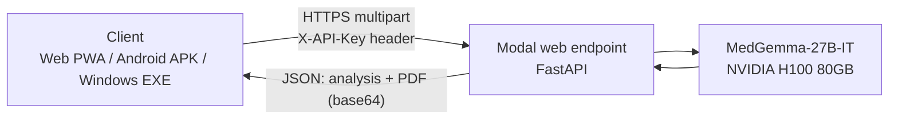

# MedGemma-27B Diagnostic Hub

**AI-assisted medical image and document analysis, powered by Google's MedGemma-27B-IT running on a serverless H100 GPU.**

[](https://huggingface.co/google/medgemma-27b-it)
[](https://modal.com)
[](https://modal.com/pricing)
[](#platforms)
[](#medical-disclaimer)

**Live app:** https://noumanasghar3000.github.io/Medgemma-27b-it-diagnostic-hub/

---

## Overview

MedGemma-27B Diagnostic Hub is a lightweight, cross-platform client for Google's **MedGemma-27B-IT** multimodal model. Upload medical images, scanned reports, and clinical notes, and receive a structured analysis (findings, possible interpretations, and uncertainties) along with a **professionally formatted PDF report** that includes the original input images.

The model runs on [Modal](https://modal.com) serverless GPUs and scales to zero when idle, so there is no always-on server to maintain. The same web app ships as an installable **PWA**, an **Android APK**, and a **Windows desktop application**.

## Features

- **Multimodal analysis** — images and text analyzed together by MedGemma-27B-IT
- **Multi-file input** — attach several images, PDFs, and documents in a single request
- **Camera capture** — take a photo directly from a phone or webcam
- **PDF report generation** — formatted report with section headings, the original input text, and the attached images embedded
- **Automatic download** — the report downloads when analysis completes, and stays available in a per-chat **PDF Reports** panel
- **Chat history** — recent conversations stored locally on your device, with a New Chat shortcut
- **Live progress indicator** — animated "Analyzing..." status while the model runs
- **Cross-platform** — one codebase delivered as web app, Android APK, and Windows installer
- **No account required** — no sign-up or login flow

## Supported inputs

| Type | Formats | How it is handled |
|---|---|---|
| Images | PNG, JPEG, WEBP, BMP, GIF, TIFF, HEIC | Resized (longest side 896 px) and sent to the model |
| PDF | `.pdf` | Each page rasterized at 150 DPI and sent as an image |
| Word | `.docx` | Text extracted and added to the prompt |
| Text | `.txt`, `.md`, `.markdown`, `.csv` | Contents added to the prompt |

Up to **8 images/pages** per request. Model output is capped at 800 new tokens.

## Architecture



- **Frontend** — static HTML/CSS/JavaScript PWA hosted on GitHub Pages
- **Backend** — a single Modal class that loads the model once per container and serves a FastAPI app
- **Model** — [`google/medgemma-27b-it`](https://huggingface.co/google/medgemma-27b-it), the multimodal 27B variant (not the text-only `medgemma-27b-text-it`), loaded in bfloat16
- **Reports** — generated server-side with ReportLab and returned to the client as base64

## Tech stack

| Layer | Technology |
|---|---|
| Model | Google MedGemma-27B-IT (Hugging Face Transformers, PyTorch) |
| Compute | Modal serverless GPU (NVIDIA H100 80GB) |
| API | FastAPI |
| Document handling | PyMuPDF, python-docx, Pillow |
| Reports | ReportLab |
| Web / PWA | Vanilla HTML, CSS, JavaScript, service worker |
| Android | Trusted Web Activity packaged with PWABuilder |
| Windows | pywebview, PyInstaller, Inno Setup |

## Project structure

```
.
├── index.html              # Web app (single file)
├── manifest.json           # PWA manifest
├── sw.js                   # Service worker
├── icons/                  # App icons (192, 512, spinner)
├── backend/
│   └── app.py              # Modal backend (model + FastAPI + PDF generation)
├── desktop/
│   ├── medgemma_desktop.py # Windows desktop wrapper
│   ├── installer.iss       # Inno Setup installer script
│   └── icon.ico
└── README.md
```

## Getting started

### Prerequisites

- Python 3.10+
- A [Modal](https://modal.com) account
- A [Hugging Face](https://huggingface.co) account with the MedGemma license accepted at
  https://huggingface.co/google/medgemma-27b-it (the model is gated)
- A Hugging Face access token with read permission

### 1. Deploy the backend on Modal

```bash
pip install modal
modal setup

# Store credentials as a Modal secret (never commit these)
modal secret create medgemma-secrets HF_TOKEN=<your_hf_token> API_KEY=<your_chosen_api_key>

cd backend
modal deploy app.py
```

`modal deploy` prints the public endpoint URL. For this project's workspace (`noumanasghar3000`) it follows the pattern:

```
https://noumanasghar3000--medgemma-app-medgemmamodel-web.modal.run
```

Verify it is live:

```bash
curl https://noumanasghar3000--medgemma-app-medgemmamodel-web.modal.run/
# {"status":"ok","model_loaded":true,"model":"google/medgemma-27b-it"}
```

### 2. Configure the frontend

In `index.html`, set the two constants near the top of the `<script>` block:

```javascript
const API_BASE = "https://noumanasghar3000--medgemma-app-medgemmamodel-web.modal.run";
const API_KEY  = "<the same API_KEY you stored in the Modal secret>";
```

### 3. Deploy to GitHub Pages

1. Push the repository to GitHub
2. Go to **Settings → Pages**
3. Set **Source** to *Deploy from a branch*, choose `main` and `/ (root)`
4. Open the published URL — the web app is live and installable as a PWA

### 4. Windows desktop app

```powershell
cd desktop
pip install pywebview pyinstaller

# Build the standalone executable
pyinstaller --onefile --windowed --name "MedGemma Medical Analysis Tool" --icon=icon.ico medgemma_desktop.py
```

The executable is written to `dist\`. To produce a proper installer, open `installer.iss` in [Inno Setup](https://jrsoftware.org/isdl.php) and choose **Build → Compile**; the installer is created in `Output\`.

Update `APP_URL` in `medgemma_desktop.py` to your GitHub Pages URL before building.

### 5. Android APK

1. Open [PWABuilder](https://www.pwabuilder.com) and enter your GitHub Pages URL
2. Choose **Package for stores → Android**
3. Set the app name and keep the generated package ID
4. Publish the generated `assetlinks.json` at `/.well-known/assetlinks.json` on your site (this removes the browser address bar inside the installed app)
5. Install the generated `.apk` on your device

## API reference

### `GET /`

Health check. Returns the loaded model identifier.

### `POST /analyze`

Analyze text and/or files.

**Headers**

| Header | Required | Description |
|---|---|---|
| `X-API-Key` | Yes | Shared API key stored in the Modal secret |

**Body** — `multipart/form-data`

| Field | Type | Description |
|---|---|---|
| `text` | string | Optional prompt or clinical notes |
| `files` | file (repeatable) | Images, PDFs, DOCX, TXT/MD/CSV |

At least one of `text` or `files` is required.

**Example**

```bash
curl -X POST "https://noumanasghar3000--medgemma-app-medgemmamodel-web.modal.run/analyze" \
  -H "X-API-Key: <your_api_key>" \
  -F "text=Describe the findings in this chest X-ray." \
  -F "files=@chest_xray.png"
```

**Response**

```json
{
  "analysis_text": "...",
  "disclaimer": "...",
  "filename": "medgemma_report_20260101_120000.pdf",
  "pdf_base64": "..."
}
```

**Errors**

| Status | Meaning |
|---|---|
| 400 | No input provided, unsupported file type, unreadable file, or more than 8 images/pages |
| 401 | Missing or invalid API key |
| 500 | Inference failed (traceback included in the response detail) |

## Cost and performance

- The 27B model needs roughly 54 GB for weights in bfloat16, so the backend runs on an **H100 80GB**
- Modal bills GPU time per second. At the time of writing an H100 costs roughly **$3.95/hour** — check [Modal pricing](https://modal.com/pricing) for current rates
- The container stays warm for **5 minutes** after the last request, then scales to zero
- The **first request after idle triggers a cold start** while the model loads; subsequent requests are much faster
- Set a spending limit in your Modal workspace (**Settings → Usage & Billing**) to avoid surprise charges

## Security notes

- Authentication is a **single shared API key** embedded in the client code. Anyone who can open the site can read it from the page source, so treat it as a convenience gate rather than strong security
- Because the backend uses paid GPU compute, rotate the key (`modal secret create ... --force`, then update `index.html`) if you suspect misuse, and keep a Modal spending limit in place
- Chat history and generated reports are stored **only in the browser's local storage** on the user's device; nothing is stored server-side
- Never commit your Hugging Face token or Modal secrets to the repository

## Medical disclaimer

This project is for **research, education, and workflow-support purposes only**. MedGemma is a research model; it is **not a medical device, is not cleared or approved for clinical use, and does not provide medical diagnoses**. Outputs can be incomplete or incorrect and must always be reviewed by a qualified healthcare professional. Do not use this tool as the sole basis for any clinical decision, and do not upload identifiable patient data without appropriate authorization and safeguards.

## Acknowledgements

- [Google Health AI — MedGemma](https://developers.google.com/health-ai-developer-foundations/medgemma)
- [Modal](https://modal.com) for serverless GPU infrastructure
- [Hugging Face](https://huggingface.co) for model hosting and Transformers

## License

Application code © 2026 Nouman Asghar. Use of the MedGemma model weights is governed by Google's [Health AI Developer Foundations Terms of Use](https://developers.google.com/health-ai-developer-foundations/terms).

## Author

**Nouman Asghar** — GitHub [@NoumanAsghar3000](https://github.com/NoumanAsghar3000) · Modal workspace `noumanasghar3000`
